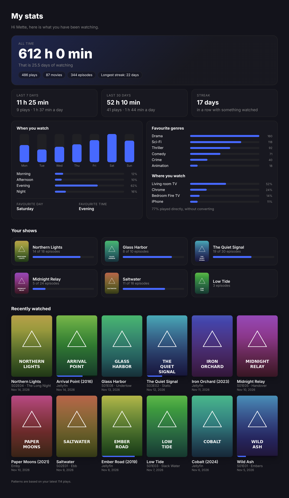

<p align="center"></p>

# Paywarr Stats

[](https://github.com/Lolles1911/Paywarr-stats/actions/workflows/tests.yml)

**Every customer's own watch statistics, on a page in the Paymenter client area.**



A [Paymenter](https://paymenter.org) extension that adds **My stats** to the
client area. [Tracearr](https://github.com/connorgallopo/tracearr) collects
what is watched on your Plex, Jellyfin and Emby servers; Paywarr Stats shows
each customer their own part of it:

- Watch time and plays for the last 7 days, the last 30 days and all time,
  plus movies and episodes watched and their current and longest streak
- When they watch: per weekday and time of day, with their favourite of each
- Their favourite genres, and where they watch (devices, and how much plays
  directly without converting)
- Their shows, with posters and how far they are ("14 of 18 episodes")
- What they watched recently, with posters: each show or movie once, with
  episode, date and how much of it

Customers log in to Paymenter as usual, Discord included through
[Paywarr](https://github.com/Lolles1911/Paywarr), and need no Tracearr account.

## What it needs

| | |
|---|---|
| **Paymenter** | v1.5.9 or newer |
| **[Paywarr](https://github.com/Lolles1911/Paywarr)** | Knows which Plex, Jellyfin and Emby users belong to which customer. Paywarr Stats reads that, so it only works next to Paywarr |
| **[Tracearr](https://github.com/connorgallopo/tracearr)** | Running and connected to your media servers, reachable from Paymenter (it can stay on your own network) |

## Installation

1. **Get the repo and install it** (Paymenter in `/opt/paymenter`; on Docker,
   give the folder with Paymenter's `docker-compose.yml` instead):

   ```bash
   git clone https://github.com/Lolles1911/Paywarr-stats.git /opt/paywarr-stats
   bash /opt/paywarr-stats/install.sh /opt/paymenter
   ```

2. **Make a key in Tracearr:** Settings → Data & API → API → **Generate key**.
   It starts with `trr_pub_` and can only read.
3. **Install it in Paymenter:** Admin → Extensions → **Available Extensions** →
   Paywarr Stats → **Install**.
4. **Set it up:** open it, fill in **Tracearr URL (internal)** (e.g.
   `http://192.168.1.10:3000`) and **Tracearr API key**, turn on **Enabled**,
   and save.

**My stats** then appears in the client area menu.

## Updating

```bash
cd /opt/paywarr-stats && git pull && bash install.sh /opt/paymenter
```

What changed in each version is on the
[Releases](https://github.com/Lolles1911/Paywarr-stats/releases) page.

## How it works

- **Plex** is supported, but less tested than Jellyfin and Emby. Customers are
  found by username, and Wizarr records a Plex user's display name, which
  usually is the same as the Plex username but can differ; such a customer
  sees "Nothing watched yet". Feedback is very welcome.
- **Only the customer's own numbers.** Paywarr records each customer's media
  server users on their subscriptions. Paywarr Stats finds those users in
  Tracearr (same server type and username, accounts not removed) and asks
  Tracearr about them only. Nobody sees anyone else's numbers, and Tracearr is
  never even asked about another customer.
- **Fast pages.** The numbers are kept for 10 minutes per customer, so page
  views don't load Tracearr.
- **Posters** come from Tracearr's image proxy, fetched by Paymenter and passed
  on, so Tracearr can stay on your own network. The page only asks for poster
  number 1, 2, 3 … of the customer's own list, never for an address, so it
  can't be used to fetch anything else; only real images are passed on (no
  SVG). Throttled to 120 a minute per customer.
- **Patterns** (weekdays, time of day, devices, streaks) come from the
  customer's latest 200 plays per media server user, in Paymenter's time zone.
- **A show on two servers** (Jellyfin and Emby) is shown once, with the
  progress of the server where the customer got furthest.
- **Tracearr down or a wrong key:** the customer sees "Your statistics can't
  be loaded right now", and the reason is in Paymenter's log.
- **History:** Tracearr can import plays from before it was installed (e.g.
  from Jellyfin's Playback Reporting plugin or Tautulli); they show up here too.
- **Languages:** English, and Danish when Paymenter is set to Danish. Add a
  language by copying `extensions/Others/PaywarrStats/lang/da.json`.

Not shown (yet): favourites. Tracearr records plays, not favourites.

## Troubleshooting

```bash
grep -h "Paywarr Stats" /opt/paymenter/storage/logs/laravel-$(date +%F).log | tail -5
```

| Message | Fix |
|---|---|
| `Tracearr rejected the API key` | Make a new key in Tracearr (Settings → Data & API → API) and paste it again |
| `Could not reach Tracearr at …` | Check the internal URL: IP and port, reachable from the Paymenter machine |
| "Nothing watched yet" for someone who has watched | Their username in Tracearr differs from the one Paywarr recorded, or the account is removed in Tracearr |

## Tests

```bash
tests/run.sh      # requires php 8.3+, python3, curl
```

The scenarios run the extension against `tests/tracearr_stub.py`, written from
Tracearr's source (public API v2 and the image proxy), with small stand-ins for
Paymenter and Laravel in `tests/shims.php`. GitHub runs them on every push.

## Files

| File | Contents |
|---|---|
| `extensions/Others/PaywarrStats/PaywarrStats.php` | The extension: settings, menu item, page, posters |
| `extensions/Others/PaywarrStats/TracearrClient.php` | The calls to Tracearr |
| `extensions/Others/PaywarrStats/routes.php` | `/stats` and `/stats/poster/{number}` |
| `extensions/Others/PaywarrStats/lang/da.json` | Danish |
| `install.sh` | Copies the extension into Paymenter |
| `tests/` | Tracearr stub, stand-ins and scenarios |
| `assets/` | Banner and the picture GitHub shows when the project is shared |

## License

[MIT](LICENSE).
