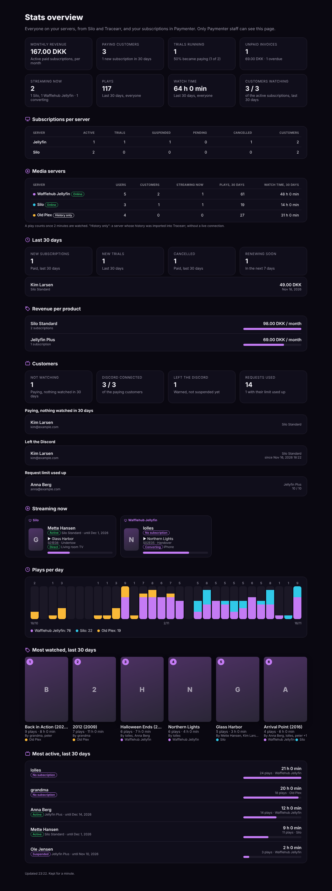

# Stats overview and reminders

## Stats overview for staff

Paymenter staff (anyone whose role may view services, `admin.services.view`)
also get **Stats overview** in the menu, at `/stats/admin`. Customers never see
it; for them the address doesn't exist.

**Your business**, from Paymenter (Paywarr's subscriptions):

- **Monthly revenue** of the active paid subscriptions (yearly plans / 12 and
  so on), per currency, and **per product**
- **Paying customers**, **trials running** and the share of finished trials
  that became paying, **unpaid invoices** and how many are overdue
- **Subscriptions per server**: active, trials, suspended, pending, cancelled
- **Last 30 days**: new subscriptions, new trials, cancelled, and who renews in
  the next 7 days
- **Customers**: paying but nothing watched in 30 days, Discord connected, who
  left the Discord, and requests used, with who has used their limit up
  (requests need Paywarr 1.23 or newer, and are kept for 10 minutes)

**Everyone on your servers**, from Silo and Tracearr together, customers or not:

- **Media servers**: users, customers, streaming now, plays and watch time per
  server, online or not; "History only" for a server whose history was
  imported into Tracearr without a live connection
- **Streaming now:** who, as the Paymenter customer with their subscription,
  status and paid-until date; what, on which device and server, played
  directly or converted, how far
- **Plays per day** over the last 30 days, coloured per server
- **Most watched** titles of the last 30 days, with posters, who watched them
  and on which server
- **Most active** users of the last 30 days, by watch time

A play counts once 2 minutes are watched (Tracearr's rule); shorter plays add
to the watch time only. Media server users that no subscription has are
marked **No subscription**, which makes left-over or unpaid accounts easy to
spot. The overview is kept for a minute. If Silo or Tracearr can't be reached,
the rest is still shown, with the reason on top. Silo's part needs a key with
full access or `admin:monitor:read`; the number of Silo users needs full
access, and shows "–" without it.

## Reminding customers who watch nothing

Fill in **Remind customers who watched nothing for (days)** (e.g. 14) on Paywarr
Stats, and a paying customer who hasn't watched anything for that long gets a
friendly mail ("We miss you"), and a private Discord message if they connected
Discord. It is sent through Paywarr (1.25 or newer), so it looks like
Paywarr's other mails. Checked daily, at most once a month per customer.

Left alone: customers newer than that many days, trials, gift cards, top-ups,
customers without a user yet (Paywarr reminds those itself), and anyone when
Tracearr or Silo doesn't answer, so nobody gets a reminder by mistake.

[← Paywarr](../README.md)
